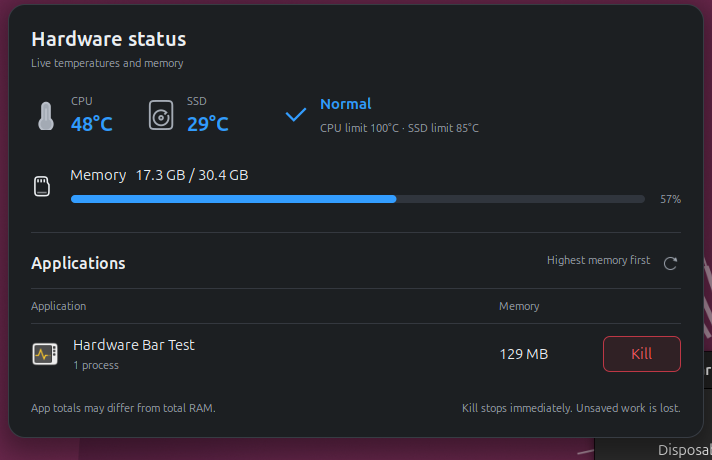

# Hardware Status Bar

A GNOME top-panel indicator that combines **temperature color** with **memory fill**, plus an application menu for finding memory-heavy apps.




These are screenshots of the running extension, not generated mockups. They show real hardware readings on the development machine. The menu uses a disposable test app to avoid exposing personal applications. Values vary by machine.

**[Download the Linux setup ZIP](https://github.com/BDC2K-DEV/Hardware-Status-Bar/releases/latest/download/hardware-status-bar-linux.zip)** · **[All releases](https://github.com/BDC2K-DEV/Hardware-Status-Bar/releases)** · [Compatibility](docs/compatibility.md)

## Supported desktops

**GNOME Shell 50 on Linux.** Tested on Ubuntu 26.04 with GNOME 50. This is not a universal Linux panel widget: KDE Plasma, Cinnamon, XFCE, and older GNOME releases are unsupported. Other distributions with GNOME 50 may work but have not been tested. The installer checks the GNOME version before changing anything.

Requirements: Python 3.9+, `gnome-extensions`, `gsettings`, Linux `/proc`, and readable hardware sensors in `/sys/class/hwmon`. No administrator access, account, network connection, or third-party Python packages are required by the installed widget.

## Install

1. Download **hardware-status-bar-linux.zip** above and extract it.
2. Open a terminal in the extracted folder and run:

   ```sh
   sh install.sh
   ```

3. Save your work, then log out and back in once. The bar starts automatically on subsequent logins.

Do **not** use `sudo`. Unsupported desktops receive a clear message. Check compatibility without installing using `sh install.sh --check`.

Prefer a download script? Download [download.sh](https://github.com/BDC2K-DEV/Hardware-Status-Bar/releases/latest/download/download.sh), inspect it, and run `sh download.sh`. It downloads the fixed release, verifies SHA-256 checksums, and extracts the installer without executing it. The script requires `curl`, `sha256sum`, and `unzip`. Checksums detect corruption; they are not an independent publisher signature.

### Remove or upgrade

Run `sh install.sh --uninstall` from the extracted setup folder. To upgrade, uninstall the old release, install the new one, and log out/back in. Uninstallation removes only this extension. The installer deliberately refuses to overwrite an existing installation.

## What the indicator means

- **Fill:** physical RAM used, calculated as `MemTotal − MemAvailable`.
- **Color:** the monitored component closest to its driver-reported temperature limit. Blue → cyan → green → amber → red.
- **Early caution:** within 20°C of that limit. **Heat warning:** within 10°C. These margins are this project's conservative policy, not manufacturer-certified warning thresholds.
- **Red outline:** warning remains visible even with low memory usage.
- **Updates:** RAM and temperature every 1.5 seconds. Fill and color interpolate at roughly 30 frames/second while changing. The animation timer still wakes when idle; this is not a zero-wakeup widget.

Click the bar to open the menu. Applications are sorted by resident memory on opening or refresh. Rows do not reorder while you interact. **Kill immediately sends SIGKILL to the sampled same-user application processes, without confirmation. Unsaved work is lost.** It may include other windows belonging to that app. Processes created after the snapshot may survive; refresh and inspect again if necessary.

App memory is summed RSS, which may double-count shared pages and differ from total RAM. The list covers applications with windows recognized by GNOME, not every background service. Process ownership, start-time checks, and pidfds reduce the risk of terminating a reused PID. Known session processes are excluded, but this is not a general-purpose security boundary.

Sensor availability varies. The current menu shows CPU and SSD values when available; a readable GPU limit may influence the bar, but a separate GPU tile is not yet implemented. Missing trustworthy limits are not guessed. This is an advisory display, not an overheating protection system; it does not control fans or shut down hardware.

## Development

```sh
python3 -m unittest discover -s tests -v
node --input-type=module --check < extension/extension.js
python3 scripts/build.py
```

`extension/` is the authoritative runtime source; `scripts/` contains installation and packaging; `tests/` validates process safety and archive boundaries; `docs/` records compatibility and real screenshots. Generated downloads live in ignored `dist/` and are attached to GitHub Releases. No duplicated historical extension modules are shipped.

See [CONTRIBUTING.md](CONTRIBUTING.md), [SECURITY.md](SECURITY.md), and [CHANGELOG.md](CHANGELOG.md). Licensed under GPL-2.0-or-later; see [LICENSE](LICENSE).
